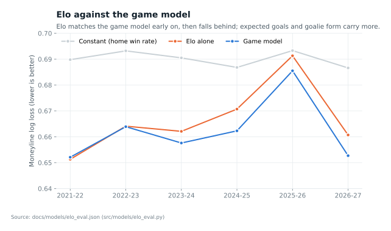
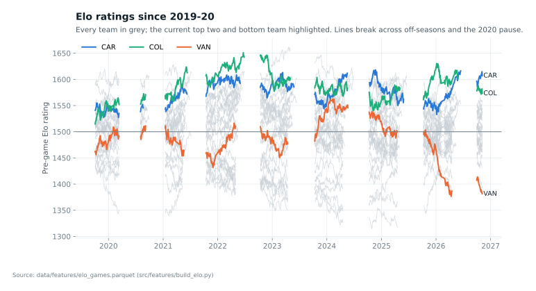
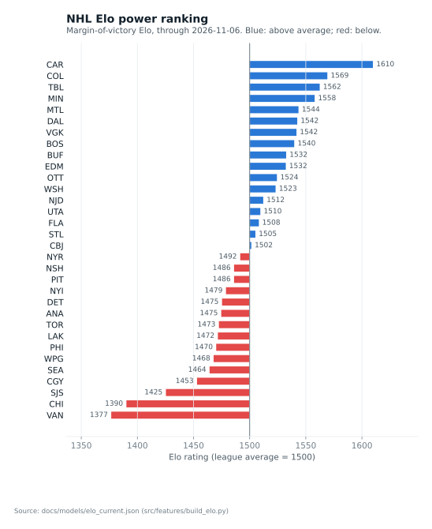

# Model Card: Team Elo Ratings

Code: `src/features/build_elo.py`, `src/models/elo_eval.py`, Elo variant of
`src/models/game_model.py` (`python3 src/models/game_model.py elo`).
Tests: `tests/test_elo_leakage.py`. Results: `docs/models/elo_results.json`,
`docs/models/elo_eval.json`, `docs/models/elo_current.json`.

## Method

Built from scratch on official results from 2019-20 (real goals for the
margin, final result for the winner), warmed up on 2018-19 MoneyPuck results.
Every team starts at 1500; Seattle starts at 1500 in 2021-22; Arizona's rating
continues into Utah.

- Win probability: 1 / (1 + 10^(-(home - away + HFA) / 400)).
- Update after each game: K x (result - expected), with the margin-of-victory
  multiplier ln(margin + 1) x 2.2 / (winner's rating edge x 0.001 + 2.2), which
  keeps heavy favorites from gaining too much from blowouts.
- An overtime or shootout win counts as S_OT (1.0 or 0.75, tuned).
- Between seasons, ratings move toward 1500: R = 1500 + C (R - 1500).
- A flat-K version (no margin multiplier) is the baseline the standard
  version has to beat.

Tuning is walk-forward. Each grid combination runs once over all games
(each pre-game probability uses only earlier games); for each test season the
combination with the lowest moneyline log loss over 2020-21 to the previous
season is used. The first grid's choices landed on its edges (home edge 20, the
lowest; carryover 0.8, the highest), so the grid was widened once: K 4-16,
home edge 0-35, carryover 0.65-1.0, S_OT 0.75 or 1.0.

Selected for 2026-27: K = 8, home edge = 20 Elo points,
carryover = 0.8, overtime win = 1.0. Earlier seasons chose K = 8
every time, home edge 20 (35 once) and carryover 0.8 to 1.0.

Leakage tests: rewriting every result after a date leaves all earlier ratings
unchanged; flipping every 2023-24 result leaves the parameters chosen for
2023-24 unchanged.

## Results: moneyline log loss on all games (lower is better)

| Season | Games | Constant | Flat Elo | Elo | Game model | Game model + Elo |
|--------|------:|------:|------:|------:|------:|------:|
| 2021-22 | 1,401 | 0.6898 | 0.6528 | 0.6513 | 0.6521 | 0.6497 |
| 2022-23 | 1,400 | 0.6932 | 0.6655 | 0.6641 | 0.6639 | 0.6626 |
| 2023-24 | 1,400 | 0.6905 | 0.6640 | 0.6621 | 0.6576 | 0.6578 |
| 2024-25 | 1,398 | 0.6868 | 0.6707 | 0.6707 | 0.6623 | 0.6620 |
| 2025-26 | 1,394 | 0.6933 | 0.6932 | 0.6913 | 0.6855 | 0.6847 |
| 2026-27 | 261 | 0.6866 | 0.6628 | 0.6607 | 0.6527 | 0.6530 |

- Elo alone beats a constant every season and the flat version in five of
  six (tied in 2024-25), so the margin multiplier earns its place.
- Elo alone is level with the game model in 2021-22 and 2022-23, then behind
  it (2025-26: 0.6913 vs 0.6855). Expected goals and goalie form carry more
  than results alone.
- Adding Elo to the game model helps in four seasons and hurts slightly in
  two, by 0.0002 to 0.0024. The average gain, about 0.0006, is within noise.

## Against the closing line

| Market, source, season | Games | Market | Game model | + Elo | Elo alone |
|---|---:|---:|---:|---:|---:|
| Moneyline, external, 2025-26 | 1,394 | 0.6808 | 0.6855 | 0.6847 | 0.6913 |
| Moneyline, SGO, 2026-27 | 261 | 0.6470 | 0.6527 | 0.6530 | 0.6607 |
| Puck line, external, 2025-26 | 1,385 | 0.6272 | 0.6246 | 0.6240 | |
| Puck line, SGO, 2026-27 | 261 | 0.6428 | 0.6421 | 0.6431 | |
| Totals, external, 2025-26 | 1,338 | 0.6893 | 0.6948 | 0.6944 | |

Elo alone trails the closing moneyline by about 0.01 log loss; with Elo the
game model still trails it. Nothing changes the earlier verdicts.

## Decision

Elo is kept as a documented team power rating and as an optional game-model
feature (the `elo` variant). The default game model stays without it: the
gain is within noise, and the default model is the one frozen for live
puck-line tracking (decisions 23 and 28).

## Power ranking (as of 2026-11-06)

| Rank | Team | Elo |
|---:|---|---:|
| 1 | CAR | 1610 |
| 2 | COL | 1569 |
| 3 | TBL | 1562 |
| 4 | MIN | 1558 |
| 5 | MTL | 1544 |
| 6 | DAL | 1542 |
| 7 | VGK | 1542 |
| 8 | BOS | 1540 |
| 9 | BUF | 1532 |
| 10 | EDM | 1532 |
| 11 | OTT | 1524 |
| 12 | WSH | 1523 |
| 13 | NJD | 1512 |
| 14 | UTA | 1510 |
| 15 | FLA | 1508 |
| 16 | STL | 1505 |
| 17 | CBJ | 1502 |
| 18 | NYR | 1492 |
| 19 | PIT | 1486 |
| 20 | NSH | 1486 |
| 21 | NYI | 1479 |
| 22 | DET | 1475 |
| 23 | ANA | 1475 |
| 24 | TOR | 1473 |
| 25 | LAK | 1472 |
| 26 | PHI | 1470 |
| 27 | WPG | 1468 |
| 28 | SEA | 1464 |
| 29 | CGY | 1453 |
| 30 | SJS | 1425 |
| 31 | CHI | 1390 |
| 32 | VAN | 1377 |
