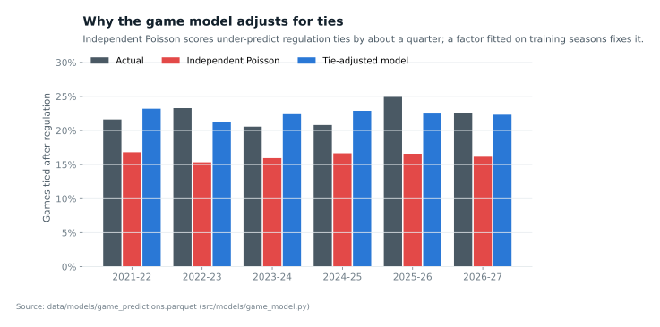
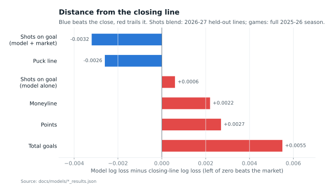

# Model Card: Game Models (Moneyline, Puck Line, Totals)

Code: `src/features/build_game_features.py`, `src/models/game_model.py`,
`src/models/game_market.py`. Tests: `tests/test_game_feature_leakage.py`.
Results: `docs/models/game_results.json`, `docs/models/game_market_results.json`.

## Method

Each team's **regulation goals** are modeled as Poisson (an overtime winner's
goal is removed; shootouts add nothing). Primary model: Poisson GLM, log
link, 27 standardized features. A gradient-boosted version was also fitted
and was worse in every market, so it is reported only in the JSON.

Features, all from earlier games only (leakage-tested):
- Team form: exponentially weighted (half-life 20 and 60 games) expected
  goals for and against, real goals, shots, shot-attempt share, 5v5 expected
  goal rates, power-play and penalty-kill rates and minutes (MoneyPuck,
  history from 2018-19; Arizona's history continues into Utah).
- Opposing starter's save percentage over his previous 40 appearances
  (shrunk toward .905) and experience. The starter is the goalie who
  actually started, not a pregame announcement (gap G-E); this gives the
  model slightly more than it would have before an unannounced start.
- Rest days and back-to-backs for both teams, home, playoff.
- League scoring level: regulation goals per team-game over the previous 300
  games on earlier dates (added in version 2, see below).

From the two teams' goal means to market probabilities:
- **Ties:** independent Poisson scores predict about 16% of games tied after
  regulation; 21-25% are. Tied scorelines are scaled up by a factor fitted on
  the training seasons (theta about 0.45-0.52), which brings predicted ties to
  22-23%.
- **Moneyline:** P(regulation win) + P(tie) x q, where q is the home team's
  share of overtime and shootout wins in training (0.46-0.51).
- **Puck line:** home -1.5 needs a 2+ goal win; home +1.5 loses only to a 2+
  goal loss. Overtime games always end one goal apart.
- **Totals:** official total = regulation goals, plus 1 if tied (the
  overtime goal or the shootout credit). Whole-number lines exclude pushes.
- **Calibration:** Platt scaling per market, fitted on out-of-sample
  predictions from earlier test seasons only (2021-22 is uncalibrated).

Walk-forward by season, test seasons 2021-22 to 2026-27 (2026-27 through
2026-11-02, where the goalie and official team-game data end).

## Results on all games (log loss, lower is better)

| Season | Games | Moneyline: constant / model | Home wins by 2+: constant / model | Over 5.5: constant / model |
|--------|------:|------:|------:|------:|
| 2021-22 | 1,401 | 0.690 / 0.652 | 0.640 / 0.624 | 0.680 / 0.704 |
| 2022-23 | 1,400 | 0.693 / 0.664 | 0.625 / 0.599 | 0.675 / 0.679 |
| 2023-24 | 1,400 | 0.691 / 0.658 | 0.635 / 0.612 | 0.685 / 0.684 |
| 2024-25 | 1,398 | 0.687 / 0.662 | 0.654 / 0.643 | 0.693 / 0.690 |
| 2025-26 | 1,394 | 0.693 / 0.686 | 0.612 / 0.598 | 0.683 / 0.681 |
| 2026-27 | 235 | 0.686 / 0.653 | 0.620 / 0.593 | 0.678 / 0.672 |

Moneyline and margin predictions carry real signal every season. Totals do
not: the predicted total correlates only 0.04-0.20 with the actual total, and
the model's scoring level misses by 0.2-0.45 goals in several seasons
(2024-25: 5.65 predicted, 5.88 actual).

## Against closing lines

Log loss on games graded with the official score; the market is de-vigged.

| Market | Source, season | Games | Market | Model (calibrated) | Constant |
|--------|----------------|------:|------:|------:|------:|
| Moneyline | external 2025-26 | 1,394 | **0.6808** | 0.6855 (raw 0.6830) | 0.6924 |
| | external 2026-27 | 231 | **0.6484** | 0.6532 | 0.6829 |
| | SGO 2025-26 (from Jan.) | 646 | **0.6739** | 0.6759 | 0.6928 |
| | SGO 2026-27 | 235 | **0.6487** | 0.6532 | 0.6844 |
| Puck line | external 2025-26 | 1,385 | 0.6272 | **0.6246** | 0.6877 |
| | external 2026-27 | 228 | 0.6495 | **0.6480** | 0.6845 |
| | SGO 2025-26 | 646 | 0.6380 | **0.6364** | 0.6855 |
| | SGO 2026-27 | 235 | 0.6503 | **0.6486** | 0.6884 |
| Totals | external 2025-26 | 1,338 | **0.6893** | 0.6948 | 0.6931 |
| | SGO 2026-27 | 235 | **0.6905** | 0.6997 | 0.6924 |

- **Moneyline:** close to the market but behind it everywhere (0.6830 raw vs
  0.6808 on the full 2025-26 season). This is better than both earlier
  projects on the same season (v2 best: 0.6867). Blend test: the model's
  weight beside the market is 0.09 (SE 0.27); it adds nothing.
- **Puck line:** the model matches or slightly beats the closing price in
  all four comparisons (three of four before the newer 2026-27 external file,
  decision 37; earlier figures: 184 moneyline games 0.6556 vs 0.6496, 182
  puck-line games 0.6565 vs 0.6563, kept in `game_market_results_xw2026-10-26.json`). Blend weight 0.58 (SE 0.31), about 1.9 standard
  errors; on 2026-27 the blend does not beat the market. Betting the model
  at the SGO close: +0.4% (SE 4.3%) at a 2-point edge, 545 bets. **Suggestive,
  not significant.**
- **Totals:** worse than a constant. No skill; not used.

No game market shows a betting edge. Moneyline ROI at the SGO close is
between -1.8% and +0.8% with standard errors of 4-7%.

### Earlier seasons: second-source prices (2026-11-09)

Code: `src/models/game_market_history.py` ->
`docs/models/game_market_history_results.json`. Sources and checks:
`docs/audit/external-odds.md`. Log loss only: neither source gives
bettable prices (decisions 38-39).

**Regulation result (home win / tie / away win after 60 minutes)**, average
closing three-way prices across bookmakers, de-vigged (median margin 6.0%):

| Season | Games | Constant | Market | Model | Actual ties | Market ties | Model ties |
|---|---:|---:|---:|---:|---:|---:|---:|
| 2021-22 | 1,401 | 1.0621 | **1.0156** | 1.0219 | 21.6% | 20.9% | 23.2% |
| 2022-23 | 1,399 | 1.0737 | **1.0314** | 1.0371 | 23.3% | 21.0% | 21.2% |
| 2023-24 | 1,400 | 1.0567 | **1.0200** | 1.0211 | 20.6% | 21.3% | 22.4% |
| 2024-25 | 1,398 | 1.0524 | **1.0251** | 1.0319 | 20.8% | 21.6% | 22.9% |
| 2025-26 | 1,394 | 1.0810 | **1.0648** | 1.0701 | 25.0% | 22.2% | 22.5% |
| 2026-27 (to Oct. 19) | 136 | 1.0702 | **1.0205** | 1.0226 | 22.8% | 22.1% | 22.3% |
| **2021-22 to 2025-26** | **6,992** | | **1.0313** | 1.0364 | 22.3% | 21.4% | 22.4% |

The model trails the market in every season, by 0.0051 over five seasons
(SE 0.0013, paired by game). The gap is not about ties: the model's tie
rate is right on average (the market's is too low), refitting the tie
adjustment to the previous season scores worse (1.0378), and giving the
model the market's own tie probability barely helps (1.0362). The market is
better at the home/away split, i.e. at rating the teams.

**Moneyline, favorite-only files** (the favorite's price, timing unknown;
margin removed approximately):

| Season | Games | Constant | Line | Model |
|---|---:|---:|---:|---:|
| 2021-22 | 1,311 | 0.6905 | **0.6422** | 0.6508 |
| 2022-23 | 1,308 | 0.6919 | **0.6525** | 0.6557 (raw) |

Same picture: the market is ahead in both seasons. With these, the
moneyline result ("close, behind the market") now holds in every season
from 2021-22 to 2026-27.

## Version history

- **v1** (no league scoring feature) and **v2** (with it) differ by at most
  0.001 log loss in any market. The feature was added after seeing the totals
  level problem; it did not fix it, and is kept because it is harmless and
  tested. Treat games after 2026-11-02 as the clean test of v2.

- **Probable-starter variant** (2026-11-07): the opposing goalie's save % and
  experience are weighted by the probable-starter model instead of taken
  from the goalie who actually started. Default files are unchanged; the
  variant writes `*_probable` outputs. Puck-line ROI at the SGO close moves
  from -0.1% to -1.2% (SE 4.2%), within noise.

## Limits

- Market comparisons cover about 1.5 seasons. Differences of 0.002-0.003 in
  log loss over 1,400 games are within noise.
- The default model uses the actual starter (gap G-E). The probable-starter
  variant (`game_model.py probable`, see
  [probable-starter-model.md](probable-starter-model.md)) uses only
  pregame information; it changes every log loss by at most 0.002, and the
  live puck-line rule uses it (decision 29).
- The SGO price is a consensus close, not one book's quote.

## Possible improvements

A scoring-level adjustment estimated within the current season, skater-level
lineup strength (injuries, scratches), and a bivariate model for totals.
