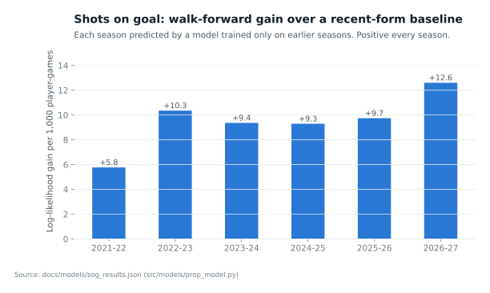
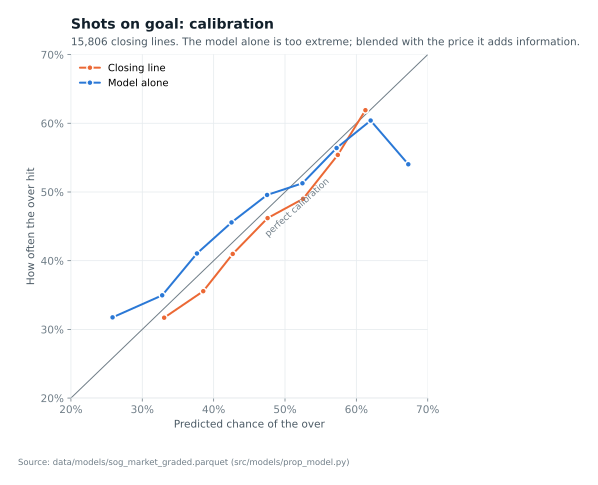

# Model Card: Shots on Goal

Code: `src/models/prop_model.py shots`, `src/models/prop_market_blend.py sog`.
Results: `docs/models/sog_results.json`, `docs/models/sog_blend_results.json`.
Features: `src/features/build_skater_features.py` (leakage-tested).

## What it predicts

The number of shots on goal a skater records in a game, as a negative
binomial distribution (mean mu, Var = mu + alpha * mu^2). The probability of
going over a prop line L is P(X > L). Whole-number lines are graded with
pushes removed.

## Models

| Name | Method |
|------|--------|
| baseline | mu = the player's exponentially weighted shots per game (half-life 10 games), no fitting |
| glm | Poisson regression, log link, 20 standardized features |
| gbm | Histogram gradient boosting with Poisson loss (300 trees, learning rate 0.05, min 200 rows per leaf) |

Features: recent, season, career and previous-season shot rates; ice time and
power-play time; shots per 60; points form; games played this season;
defenseman, home, back-to-back and playoff flags; own team's shots for and
opponent's shots allowed over their last 20 games. Players need at least 5
earlier games in the data.

## Validation

Walk-forward by season: each test season is predicted by models trained only
on earlier seasons (training starts 2019-20). The negative binomial alpha is
fitted on the training seasons only.

### All player-games (negative binomial log-likelihood per game, higher is better)

| Test season | Player-games | baseline | glm | gbm | Actual zero-shot rate | gbm predicted |
|-------------|-------------:|---------:|----:|----:|-----:|-----:|
| 2021-22 | 49,645 | -1.6292 | -1.6233 | -1.6234 | 22.7% | |
| 2022-23 | 49,860 | -1.6142 | -1.6039 | -1.6039 | 23.2% | 22.0% |
| 2023-24 | 49,889 | -1.5877 | -1.5807 | -1.5784 | 24.7% | 23.3% |
| 2024-25 | 49,800 | -1.5563 | -1.5486 | -1.5470 | 26.5% | 25.9% |
| 2025-26 | 49,627 | -1.5465 | -1.5387 | -1.5368 | 27.1% | 26.6% |
| 2026-27 (to 11-06) | 9,323 | -1.5386 | -1.5285 | -1.5259 | 27.2% | 27.0% |

The fitted models beat the baseline in every season, and gbm is best from
2023-24 on. League shot volume per skater has fallen each season (1.69 to
1.53 per game); the models track it because recent-form features lead.

### Against closing prop prices (SportsGameOdds consensus close)

15,777 graded lines in 910 games, 2026-01-17 to 2026-11-06 (lines 1.5: 9,697;
2.5: 4,970; 3.5: 1,025). Median margin 7.0%; overs hit 47.0%.

| | Log loss | Note |
|---|---:|---|
| Market (de-vigged close) | 0.6815 | |
| Constant | 0.6914 | |
| baseline | 0.6874 | |
| glm | 0.6844 | |
| gbm | 0.6821 | beats the market in 2026-27 (0.6779 vs 0.6797), not in 2025-26 (0.6845 vs 0.6825) |

Betting the model alone at a 3-point edge loses (gbm -1.8%, SE 0.95%, on
9,641 bets), mostly unders. The model's probabilities are too extreme: when
gbm says under 30%, the over hits 31.7%; when it says 60-70%, it hits 59.2%.

### Does the model add information beyond the market?

Logistic regression y ~ logit(p_market) + logit(p_model), fitted on the
2025-26 lines (9,963) and tested on 2026-27 lines (5,814) that it never saw:

| | Market weight | Model weight (SE, game-clustered) | 2026-27 log loss |
|---|---:|---:|---:|
| Market alone | | | 0.6797 |
| Market + glm | 0.79 | 0.27 (0.09) | 0.6773 |
| Market + gbm | 0.70 | 0.35 (0.09) | 0.6766 |

The model's weight is about 3.9 standard errors above zero: it carries shot
information the closing price has not fully priced.

Betting the blend on 2026-27 at the closing price (rerun 2026-11-07 after games
from 2026-11-03 to 11-06 gained real team and goalie context; the first run,
with those filled by league averages, gave +9.2% on 824 bets at 4 points; a
later fix to player-name matching added 29 lines to 2025-26, which moved the
blend coefficients slightly and the 4-point result from 839 bets at +8.4% to
the figures below):

| Edge threshold | Bets | ROI | SE (game-clustered) |
|---:|---:|---:|---:|
| 2 points | 2,725 | +1.2% | 1.6% |
| 4 points | 907 | +8.3% | 2.7% |
| 6 points | 262 | +19.9% | 4.5% |

## Limits (read before quoting the ROI)

1. **One short test period.** About 250 games of one season. The thresholds
   were not fixed in advance and three are shown; the 2-point result is
   within noise. Treat the ROI as a hypothesis to confirm on the rest of
   2026-27, not as a result.
2. **The price may not be bettable.** The consensus closing price is a
   summary across books, not a quote from one book. Individual books may
   offer better or worse.
3. **The model is at an information disadvantage, not an advantage.**
   Features stop at the previous game; the closing price knows same-day
   lineups and news. A contaminated (in-game) market price would make the
   market look better, not worse, so it cannot explain the model's weight.
4. **7.5% of prop lines are unmatched** to an NHL player by name and are
   left out.
5. Bets in the same game are correlated; standard errors are clustered by
   game for that reason.

## Next

Live tracking on games after 2026-11-06 with the rule fixed in advance:
[docs/live/README.md](../live/README.md).

## Player matching (2026-11-07)

An alias list for 12 players the provider lists under another first name
(Nick/Nicholas Robertson, Freddy/Frederick Gaudreau and others) cut unmatched
shots and points lines from 3.4% to 3.1%. The rest are players with no
box-score row that night (scratched), whose bets are void. Current figures:
15,806 graded shots lines; model 0.6821 vs market 0.6815; blend on 2026-27
0.6764 vs 0.6796, model weight 0.36 (SE 0.09).

## Closing-line value at the opening price (2026-11-07)

Code: `src/models/sog_clv.py`. Results: `docs/models/sog_clv_results.json`.

The question: are the model's picks, taken at the opening price, worth more
than the closing price says? Data: SportsGameOdds consensus opening and
closing prices on all 15,806 graded lines from 2026-01-16 to 2026-11-06
(1,076 games). 91.4% of lines close at the line they opened on. Median margin
is 7.1% at the open and 7.0% at the close. The model's opening probability
uses the gradient-boosted negative binomial at the opening line. That model
was trained on earlier seasons only, so every line is out of sample.

**1. The market moves toward the model.** On same-line lines, the move from
the opening to the closing fair probability (over side) is regressed on the
model's opening edge. Standard errors are clustered by game.

| Predictor | Slope | SE | R² |
|-----------|------:|---:|---:|
| Model | 0.207 | 0.007 | 0.181 |
| Model-free recent average (EWMA of shots) | 0.151 | 0.005 | 0.148 |
| Both: model / baseline | 0.148 / 0.069 | 0.007 / 0.005 | 0.198 |

Part of what the market corrects between open and close is plain staleness
on recent form, which even the model-free average catches. The model predicts
the move better and keeps most of its slope next to the baseline. The effect
is larger in 2026-27 (slope 0.27, SE 0.010) than in 2025-26 (0.14, SE 0.008).

**2. But the classic closing-line-value test fails on price.** For a bet at
the open, CLV is the closing fair probability of the side minus the opening
price's break-even probability.

| Rule (both seasons) | Bets | Mean CLV, same-line bets | Market move toward bet | Lines that moved: our way / against | ROI at open (SE) |
|------|-----:|------:|------:|------:|------:|
| Model, 2-point edge | 12,206 | -2.4 pts (0.05) | +1.1 pts | 1,137 / 94 | +3.2% (0.9) |
| Model, 4-point edge | 9,008 | -2.1 pts (0.06) | +1.5 pts | 1,057 / 56 | +5.5% (1.0) |
| Model, 6-point edge | 6,320 | -1.8 pts (0.07) | +1.8 pts | 987 / 32 | +9.0% (1.3) |
| Baseline, 4-point edge | 9,467 | -2.2 pts (0.06) | +1.4 pts | 1,042 / 66 | +1.6% (1.0) |
| Control: every line, both sides | 31,612 | -3.5 pts | 0 | | -6.0% |

The market moves our way by 1.1-1.8 points on average, but each side of an
opening price carries about 3.5 points of margin. So a bet at the open is,
on average, *worse* than the fair close: it beats the close on price only
29% of the time. Note that "same-line" and "line moved" are known only
after the close. The ROI over all bets is the ex-ante result.

**3. Where the opening-price profit comes from.** At a 4-point edge, model alone:

| Bets | Count | Win rate at open line | Close fair prob. | Break-even at open | ROI at open (SE) | ROI at close |
|------|------:|------:|------:|------:|------:|------:|
| Same line | 7,895 | 55.0% | 52.0% | 54.1% | +2.0% (1.1) | -1.3% |
| Line moved | 1,113 | 67.0% | 43.2% | 53.5% | +30.8% | -3.4% |
| Control: every under, line moved | 1,354 | 58.2% | 48.3% | 52.0% | +16.3% (3.0) | -2.4% |

Most of the profit at the open is the 7% of bets whose line later moved, 95%
of them in the bet's favor. Even betting every under on lines that later
moved earns +16%, so this is mostly the line move itself. It is real money
only if those opening lines could be bet in size. The SportsGameOdds open is
a consensus of each book's first posted line, with no timestamp or limits,
and that cannot be checked here.

**4. Walk-forward blend at the open.** Fitted on 2025-26 opening prices and
bet on 2026-27 only. Weights: market 0.37 (SE 0.11), model 0.64 (SE 0.08).
At the close, the weights were 0.58 and 0.42: the opening price is a weaker
market. At a 4-point edge: 2,574 bets, ROI at the open +9.7% (SE 1.9);
same-line bets +6.6% (SE 2.0, 2,253 bets) against +0.6% for the same picks
at the close; mean CLV -1.05 points.

**Verdict.** The model carries information that the opening market lacks
and the closing market partly absorbs, beyond what recent form alone
explains. That supports the earlier finding that the model adds information
to the price. But on price, bets at the open do not beat the fair close on
average, because the opening margin is larger than the move. The large
opening-price ROI rests mainly on lines that moved, whose opening prices may
not have been available to bet. Betting at the open is therefore not
adopted (decision 30). The frozen live test stays at the closing price. A
per-book, timestamped check of opening lines (PuckAPI `get_prop_movement`,
10 credits per player-game) could settle whether the opening prices were
bettable.
